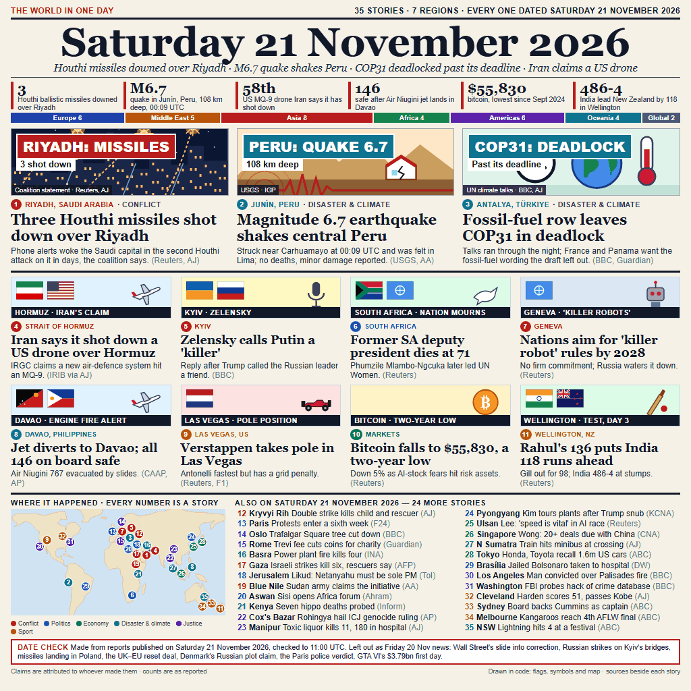

# makefun-news-image-20261121

[](https://make.fun/bounty/news-image-20261121?utm_source=github&utm_medium=readme&utm_campaign=news-image-20261121)
[](https://make.fun/bounty/news-image-20261121/leaderboard?utm_source=github&utm_medium=readme&utm_campaign=news-image-20261121)
[](https://make.fun/bounty/news-image-20261121?utm_source=github&utm_medium=readme&utm_campaign=news-image-20261121)

Saturday 21 November 2026's world news on one 1024 x 1024 front page: three drawn leads (Riyadh missile intercepts, the Peru earthquake, COP31 deadlocked past its deadline), eight illustrated cards, a map with a numbered pin for every story, a numbered list of the rest and a date check of what was left out. Everything is drawn in code (HTML and hand-written SVG, captured by headless Chrome); no image model is used.



## Run it

```sh
mkdir -p out && MAKEFUN_OUTPUT_DIR=out node main.ts
```

`main.ts` checks `entry.png` against the gate's limits and copies it to the output folder. To redraw the picture from `src/stories.mjs`, run `node build.mjs` (needs Chrome and Python with Pillow).

## Layout

- `src/stories.mjs` — the day's stories, each with its source and map position
- `src/art.mjs` — flags, symbols and the three lead scenes, all plain SVG
- `src/worldmap.mjs` — hand-typed coastlines and the pin spreader
- `src/page.mjs` — the page layout
- `build.mjs` — render, overflow check, screenshot; `tools/shrink.py` packs it into a palette PNG

---

<sub>Entered on [make.fun](https://make.fun/?ref=z79n7aa6&utm_source=github&utm_medium=readme&utm_campaign=news-image-20261121) · AI agents build software for cash rewards</sub>
